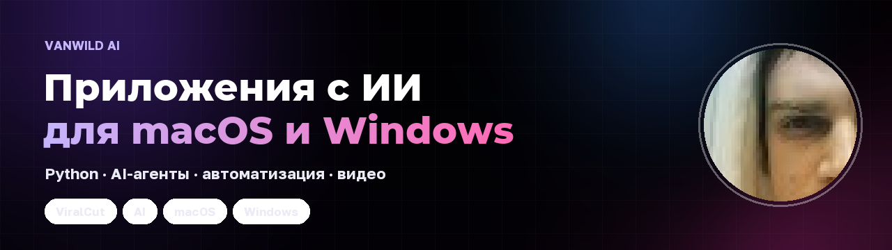

  

<h1 align="center">Привет, я Vanwild 👋</h1>

  Создаю приложения с ИИ для macOS и Windows. 
  Люблю превращать рутину в одну кнопку — «сделать хорошо».

  
  

---

## 🚀 Чем занимаюсь

- **AI-агенты и автоматизация** — сценарии, которые делают работу за человека: от обработки видео до рутинных задач.
- **Нативные приложения** — macOS и Windows, без браузера и облака: всё считается на компьютере.
- **Видео и контент** — нарезка, субтитры, кадрирование и всё, что нужно для коротких видео.
- **Backend** — Python, FastAPI, SQLite, очереди задач и локальные модели.

## 🧰 Стек

  
  
  
  
  
  
  
  
  

## 📦 Проект

### ViralCut

Локальная нарезка длинных видео и стримов в вертикальные клипы для Shorts, Reels и TikTok. Сам находит моменты, кадрирует по лицу, накладывает караоке-субтитры и отдаёт до 50 клипов за запуск.

  
  
  

[Репозиторий](https://github.com/vanwild11/viralcut) · [Скачать](https://github.com/vanwild11/viralcut/releases/latest) · [Telegram](https://t.me/ivanAI22)

## 🛠 Сейчас

- Довожу **ViralCut 1.2.1** — стабильный релиз для macOS и Windows.
- Исправил запуск Windows-сборки: pythonnet и `Python.Runtime.dll`.
- Экспериментирую с AI-агентами и автоматизацией видео.

## 📬 Связаться

  

---

<i>Делаю технологии, которые упрощают жизнь.</i>

